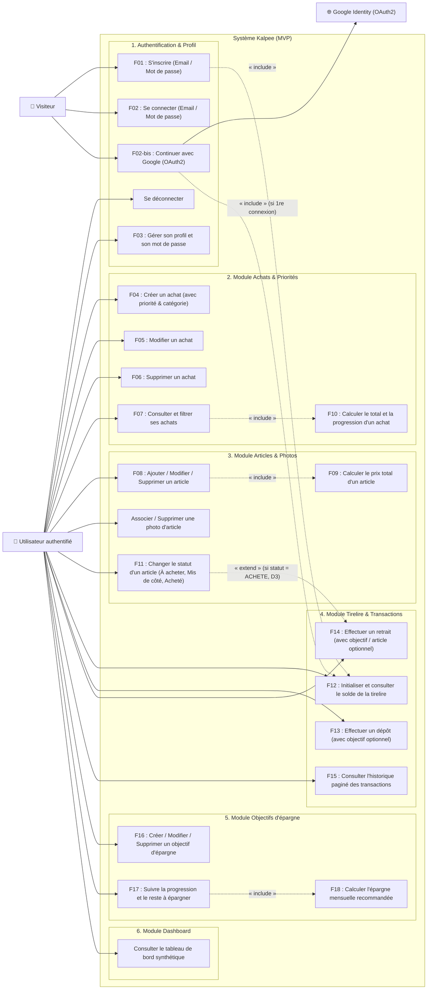
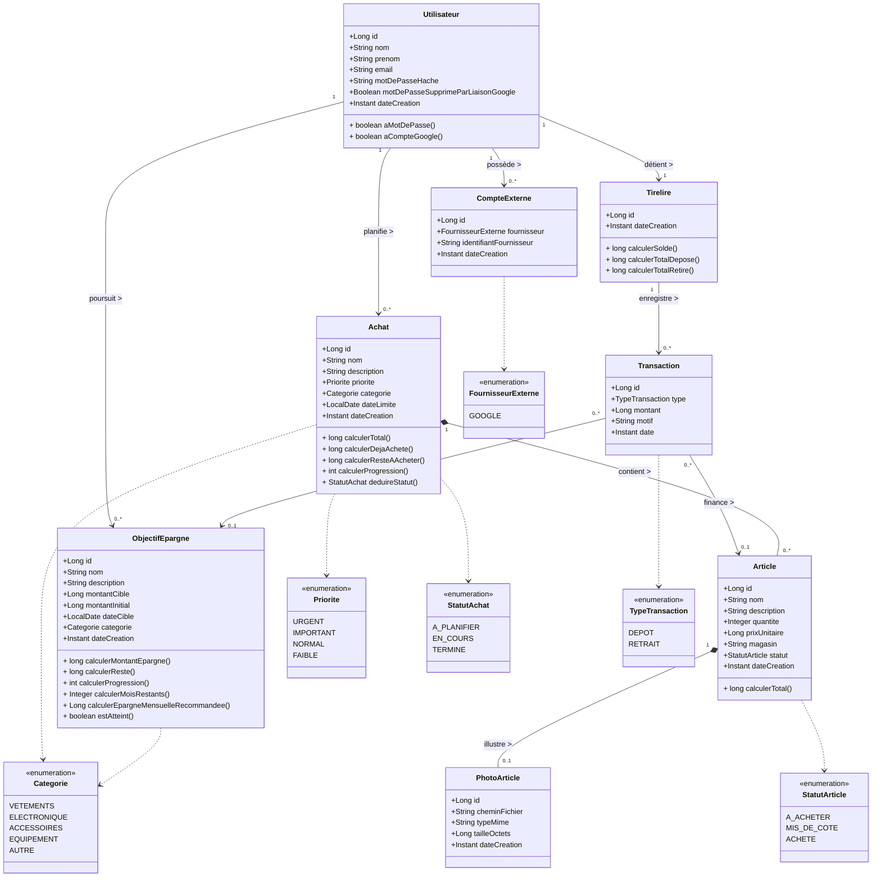
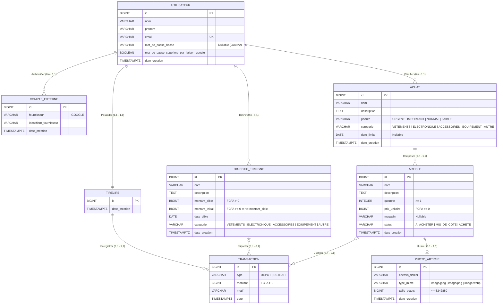

# Modélisation UML et Merise — Kalpee MVP

Ce document regroupe l'ensemble des modèles d'analyse et de conception du projet **Kalpee** :
1. **Diagramme de cas d'utilisation (UML)** et fiches descriptives détaillées (F01 à F18 + OAuth2 Google).
2. **Diagramme de classes du domaine (UML)** avec attributs, types, méthodes métier calculées et multiplicités.
3. **Modèle Conceptuel de Données (MCD Merise)**, dictionnaire des données complet et règles de gestion (RB01 à RB16).
4. **Modèle Logique de Données (MLD)** et **Modèle Physique de Données (MPD PostgreSQL)** complet avec contraintes et index.

---

## 1. Diagramme de cas d'utilisation (UML)

### 1.1 Acteurs du système

| Acteur | Type | Rôle |
|---|---|---|
| **Visiteur (Non authentifié)** | Principal | Peut créer un compte (`F01`), se connecter par email/mot de passe (`F02`) ou s'authentifier via Google OAuth2. |
| **Utilisateur authentifié** | Principal | Hérite du visiteur une fois connecté. Gère son profil, ses achats, ses articles et photos, sa tirelire, ses transactions, ses objectifs d'épargne et consulte son dashboard. |
| **Google Identity (OAuth2 / OIDC)** | Secondaire (Externe) | Fournisseur d'identité externe certifiant l'adresse email et le profil lors de la connexion sociale (décisions `D12`, `D13`, règle `RB15`). |

### 1.2 Diagramme de cas d'utilisation (Mermaid)



### 1.3 Description détaillée des cas d'utilisation (F01 à F18 + Connexion Google)

| Code | Cas d'utilisation | Acteur(s) | Préconditions | Scénario nominal & Règles associées | Postconditions |
|---|---|---|---|---|---|
| **F01** | **Inscription** | Visiteur | Aucune session active. | Saisie du nom, prénom, email (normalisé en minuscules) et mot de passe ($\ge 8$ caractères). Vérification de l'unicité de l'email. Hachage BCrypt du mot de passe. Création automatique de la `Tirelire` associée (`F12`). | Compte et tirelire créés, cookie JWT `KALPEE_SESSION` déposé, redirection vers `/dashboard`. |
| **F02** | **Connexion (Email / Mot de passe)** | Visiteur | Compte existant avec mot de passe défini (`aMotDePasse = true`). | Vérification du couple email/mot de passe et contrôle du limiteur de tentatives (anti-bruteforce). Émission du cookie JWT HttpOnly. | Session ouverte pour 24h, redirection vers `/dashboard`. |
| **F02-bis** | **Connexion avec Google (OAuth2)** | Visiteur, Google Identity | Compte Google avec `email_verified = true` (`RB15`). | Flux OAuth2 Authorization Code + PKCE (`D12`). Si le compte externe existe, connexion directe. Si l'email correspond à un compte classique existant, liaison automatique et suppression de l'ancien mot de passe (`D13`). Sinon, création de l'utilisateur et de sa tirelire. | Session ouverte (`KALPEE_SESSION`), redirection vers `/dashboard` (ou `/profil?googleLinked=true` si liaison avec suppression de mot de passe). |
| **F03** | **Gestion du profil et du mot de passe** | Utilisateur | Authentifié. | Consultation et modification du nom, prénom et email. Modification du mot de passe (mot de passe actuel requis si `aMotDePasse = true`) ou définition d'un premier mot de passe pour un compte créé via Google (`RB16`). | Profil ou mot de passe mis à jour en base. |
| **F04** | **Création d'un achat** | Utilisateur | Authentifié. | Saisie du nom, description, priorité (`URGENT`, `IMPORTANT`, `NORMAL`, `FAIBLE`), catégorie fixe (`D10`) et date limite optionnelle. Le statut initial est déduit à `A_PLANIFIER` (`D8`). | Achat créé et rattaché à l'utilisateur (`RB02`), ouverture directe de l'ajout d'articles. |
| **F05** | **Modification d'un achat** | Utilisateur | Authentifié, propriétaire de l'achat (`RB01`). | Modification du nom, de la description, de la priorité, de la catégorie ou de la date limite. | Achat mis à jour. |
| **F06** | **Suppression d'un achat** | Utilisateur | Authentifié, propriétaire de l'achat (`RB01`). | Demande de confirmation modale. Suppression en cascade des articles de l'achat et de leurs fichiers photos sur le disque. Les transactions liées aux articles supprimés sont conservées avec `article_id = NULL`. | Achat, articles et photos supprimés sans altérer le solde de la tirelire. |
| **F07** | **Consultation et filtrage des achats** | Utilisateur | Authentifié. | Liste des achats de l'utilisateur avec recherche textuelle (nom/description) et filtre par priorité. Affichage du détail d'un achat et de ses articles. | Retourne les achats avec toutes les valeurs calculées à la volée (`D4`). |
| **F08** | **Ajout / Modification / Suppression d'article** | Utilisateur | Authentifié, propriétaire de l'achat parent (`RB03`). | Saisie du nom, description, quantité ($\ge 1$, `RB04`), prix unitaire ($\ge 0$ FCFA, `RB05`), magasin/source, statut (`A_ACHETER`, `MIS_DE_COTE`, `ACHETE`). Téléversement optionnel d'une photo (JPEG/PNG/WebP $\le 5\text{ Mo}$). | Article enregistré ; total et statut de l'achat parent recalculés automatiquement. |
| **F09** | **Calcul du prix d'un article** | Système | Article existant ou en cours de lecture. | Calcul automatique à la lecture : $\text{Total article} = \text{quantité} \times \text{prix unitaire}$. | Montant entier en FCFA retourné dans `ArticleDto`. |
| **F10** | **Calcul du prix et de la progression d'un achat** | Système | Achat existant. | Calcul automatique à la lecture (`RB08`, `RB09`, `D4`, `D9`) : somme des totaux des articles, somme des articles `ACHETE`, reste à acheter, pourcentage de progression en montant et statut déduit (`D8`). | Métriques d'avancement retournées dans `AchatDto`. |
| **F11** | **Gestion des statuts d'article & Retrait suggéré** | Utilisateur | Authentifié, propriétaire de l'article. | Changement du statut entre `A_ACHETER`, `MIS_DE_COTE` et `ACHETE`. Lorsque le statut passe à `ACHETE`, l'API renvoie un objet `retraitSuggere` (montant = total de l'article, motif pré-rempli, `articleId`) selon `D3`. | Statut de l'article mis à jour ; modale de proposition de retrait affichée au front. |
| **F12** | **Création et consultation de la tirelire** | Système / Utilisateur | Inscription ou connexion. | Création automatique d'une tirelire 1–1 à l'inscription. À la consultation, calcul dynamique du solde ($\sum \text{Dépôts} - \sum \text{Retraits}$), du total déposé et du total retiré (`RB07`, `D4`). | État financier exact retourné sans redondance de stockage. |
| **F13** | **Dépôt dans la tirelire** | Utilisateur | Authentifié. | Saisie d'un montant strictement positif (`RB06`), d'un motif et optionnellement d'un objectif d'épargne appartenant à l'utilisateur (`D1`, `RB14`). | Transaction de type `DEPOT` enregistrée ; solde de la tirelire (et épargne de l'objectif si étiqueté) augmenté. |
| **F14** | **Retrait de la tirelire** | Utilisateur | Authentifié. | Verrouillage pessimiste (`SELECT ... FOR UPDATE`) de la tirelire. Vérification que $\text{montant} > 0$ (`RB06`), que $\text{montant} \le \text{solde disponible}$ (`RB12`, `D2`) et, si un objectif est étiqueté, que $\text{montant} \le \text{montant épargné de l'objectif}$ (`RB13`). Liaison optionnelle avec un `articleId` (`RB14`). | Transaction de type `RETRAIT` enregistrée ; solde diminué en toute sécurité concurrente. |
| **F15** | **Historique des transactions** | Utilisateur | Authentifié. | Consultation paginée (par pages de 20, triées de la plus récente à la plus ancienne) des transactions de la tirelire avec le nom de l'objectif ou de l'article associé. | Page de `TransactionDto` retournée. |
| **F16** | **Création / Modification / Suppression d'objectif** | Utilisateur | Authentifié. | Saisie du nom, description, catégorie (`D10`), montant cible ($> 0$, `RB10`), montant initial ($\ge 0$ et $\le \text{cible}$) et date cible cohérente (`RB11`). La suppression conserve les transactions en mettant `objectif_id = NULL`. | Objectif enregistré ou supprimé. |
| **F17** | **Suivi d'un objectif d'épargne** | Système / Utilisateur | Objectif existant. | Calcul dynamique (`D1`, `D4`) : $\text{Montant épargné} = \text{montant initial} + \sum \text{dépôts liés} - \sum \text{retraits liés}$, $\text{Reste} = \max(0, \text{cible} - \text{épargné})$, $\text{Progression} = \min(100, \text{épargné} / \text{cible} \times 100)$. | État d'avancement retourné dans `ObjectifDto`. |
| **F18** | **Calcul de l'effort mensuel d'épargne** | Système | Objectif avec date cible future et non atteint. | Calcul du nombre de mois restants (arrondi au supérieur, minimum 1) entre la date du jour et la date cible. $\text{Épargne mensuelle recommandée} = \lceil \text{Reste} / \text{moisRestants} \rceil$. Renvoie `null` si l'objectif est atteint ou si la date cible est dépassée. | Recommandation mensuelle en FCFA fournie à l'utilisateur. |

---

## 2. Diagramme de classes (UML)

Le diagramme ci-dessous représente les entités du domaine métier de **Kalpee**, leurs énumérations, leurs attributs persistés ainsi que les méthodes métier calculant les agrégats à la volée (conformément à la décision `D4`).



---

## 3. Modèle Conceptuel de Données (MCD — Merise)

### 3.1 Schéma Entité-Association (Mermaid `erDiagram`)



### 3.2 Dictionnaire des données complet

Tous les montants monétaires sont exprimés en **Francs CFA (FCFA)** sous forme d'entiers 64 bits (`BIGINT`) sans décimales. Les données calculées (solde, totaux, progressions, statut d'achat, épargne mensuelle recommandée) ne figurent pas dans les tables conformément à la décision `D4` et aux règles `RB07` et `RB08`.

| Entité | Code attribut | Libellé / Rôle | Type SQL | Taille / Domaine | Obligatoire | Règles / Contraintes |
|---|---|---|---|---|---|---|
| **UTILISATEUR** | `id` | Identifiant de l'utilisateur | `BIGSERIAL` | Entier $> 0$ | Oui | Clé primaire (`PK`) |
| | `nom` | Nom de famille | `VARCHAR` | 1 à 100 car. | Oui | Non vide |
| | `prenom` | Prénom | `VARCHAR` | 1 à 100 car. | Oui | Non vide |
| | `email` | Adresse électronique | `VARCHAR` | 3 à 255 car. | Oui | Unique (`UNIQUE`), stocké en minuscules |
| | `mot_de_passe_hache` | Empreinte BCrypt du mot de passe | `VARCHAR` | 60 à 255 car. | Non | Nullable si compte créé via Google (`RB16`) |
| | `mot_de_passe_supprime_par_liaison_google` | Indicateur d'écrasement du mot de passe suite à liaison OAuth2 | `BOOLEAN` | `TRUE` / `FALSE` | Oui | Défaut `FALSE` (`D13`) |
| | `date_creation` | Date d'inscription | `TIMESTAMPTZ` | ISO-8601 UTC | Oui | Défaut `NOW()` |
| **COMPTE_EXTERNE** | `id` | Identifiant du lien OAuth2 | `BIGSERIAL` | Entier $> 0$ | Oui | Clé primaire (`PK`) |
| | `utilisateur_id` | Utilisateur rattaché | `BIGINT` | Entier $> 0$ | Oui | `FK` vers `utilisateur(id)` `ON DELETE CASCADE` |
| | `fournisseur` | Nom du fournisseur OAuth2 | `VARCHAR` | 30 car. (`GOOGLE`) | Oui | Prévu pour accueillir `APPLE` plus tard (`D14`) |
| | `identifiant_fournisseur` | Identifiant unique (`sub` OIDC) chez le fournisseur | `VARCHAR` | 1 à 255 car. | Oui | Couple `(fournisseur, identifiant_fournisseur)` unique |
| | `date_creation` | Date de liaison du compte | `TIMESTAMPTZ` | ISO-8601 UTC | Oui | Défaut `NOW()` |
| **TIRELIRE** | `id` | Identifiant de la tirelire | `BIGSERIAL` | Entier $> 0$ | Oui | Clé primaire (`PK`) |
| | `utilisateur_id` | Propriétaire unique | `BIGINT` | Entier $> 0$ | Oui | `FK` unique (`UNIQUE`) vers `utilisateur(id)` |
| | `date_creation` | Date de création | `TIMESTAMPTZ` | ISO-8601 UTC | Oui | Défaut `NOW()` |
| **TRANSACTION** | `id` | Identifiant de la transaction | `BIGSERIAL` | Entier $> 0$ | Oui | Clé primaire (`PK`) |
| | `tirelire_id` | Tirelire mouvementée | `BIGINT` | Entier $> 0$ | Oui | `FK` vers `tirelire(id)` `ON DELETE CASCADE` |
| | `type` | Sens de l'opération | `VARCHAR` | `DEPOT`, `RETRAIT` | Oui | `CHECK (type IN ('DEPOT', 'RETRAIT'))` |
| | `montant` | Montant en FCFA | `BIGINT` | $> 0$ | Oui | `CHECK (montant > 0)` (`RB06`) |
| | `motif` | Libellé / justification | `VARCHAR` | 1 à 255 car. | Oui | Non vide |
| | `date` | Horodatage de l'opération | `TIMESTAMPTZ` | ISO-8601 UTC | Oui | Défaut `NOW()` |
| | `objectif_id` | Objectif d'épargne étiqueté | `BIGINT` | Entier $> 0$ | Non | `FK` vers `objectif_epargne(id)` `ON DELETE SET NULL` (`D1`) |
| | `article_id` | Article financé par le retrait | `BIGINT` | Entier $> 0$ | Non | `FK` vers `article(id)` `ON DELETE SET NULL` (`D3`) |
| **ACHAT** | `id` | Identifiant de l'achat | `BIGSERIAL` | Entier $> 0$ | Oui | Clé primaire (`PK`) |
| | `utilisateur_id` | Propriétaire de l'achat | `BIGINT` | Entier $> 0$ | Oui | `FK` vers `utilisateur(id)` `ON DELETE CASCADE` (`RB02`) |
| | `nom` | Titre de l'achat | `VARCHAR` | 1 à 150 car. | Oui | Non vide |
| | `description` | Description détaillée | `TEXT` | 0 à 2000 car. | Non | Nullable |
| | `priorite` | Niveau de priorité | `VARCHAR` | `URGENT`, `IMPORTANT`, `NORMAL`, `FAIBLE` | Oui | `CHECK` sur l'énumération |
| | `categorie` | Catégorie d'achat | `VARCHAR` | `VETEMENTS`, `ELECTRONIQUE`, `ACCESSOIRES`, `EQUIPEMENT`, `AUTRE` | Oui | Liste fixe (`D10`) |
| | `date_limite` | Échéance souhaitée | `DATE` | `YYYY-MM-DD` | Non | Nullable |
| | `date_creation` | Date de création | `TIMESTAMPTZ` | ISO-8601 UTC | Oui | Défaut `NOW()` |
| **ARTICLE** | `id` | Identifiant de l'article | `BIGSERIAL` | Entier $> 0$ | Oui | Clé primaire (`PK`) |
| | `achat_id` | Achat parent | `BIGINT` | Entier $> 0$ | Oui | `FK` vers `achat(id)` `ON DELETE CASCADE` (`RB03`) |
| | `nom` | Désignation de l'article | `VARCHAR` | 1 à 150 car. | Oui | Non vide |
| | `description` | Précisions (taille, modèle…) | `TEXT` | 0 à 1000 car. | Non | Nullable |
| | `quantite` | Nombre d'unités | `INTEGER` | $\ge 1$ | Oui | `CHECK (quantite >= 1)` (`RB04`) |
| | `prix_unitaire` | Prix d'une unité en FCFA | `BIGINT` | $\ge 0$ | Oui | `CHECK (prix_unitaire >= 0)` (`RB05`) |
| | `magasin` | Boutique ou source | `VARCHAR` | 0 à 150 car. | Non | Nullable |
| | `statut` | État d'acquisition | `VARCHAR` | `A_ACHETER`, `MIS_DE_COTE`, `ACHETE` | Oui | Défaut `A_ACHETER` |
| | `date_creation` | Date d'ajout | `TIMESTAMPTZ` | ISO-8601 UTC | Oui | Défaut `NOW()` |
| **PHOTO_ARTICLE** | `id` | Identifiant de la photo | `BIGSERIAL` | Entier $> 0$ | Oui | Clé primaire (`PK`) |
| | `article_id` | Article illustré | `BIGINT` | Entier $> 0$ | Oui | `FK` unique (`UNIQUE`) vers `article(id)` `ON DELETE CASCADE` |
| | `chemin_fichier` | Nom aléatoire sur le volume | `VARCHAR` | 1 à 255 car. | Oui | UUID + extension vérifiée |
| | `type_mime` | Type MIME réel du fichier | `VARCHAR` | `image/jpeg`, `image/png`, `image/webp` | Oui | Vérifié par magic bytes |
| | `taille_octets` | Poids du fichier en octets | `BIGINT` | $1$ à $5\,242\,880$ | Oui | Max 5 Mo |
| | `date_creation` | Date de téléversement | `TIMESTAMPTZ` | ISO-8601 UTC | Oui | Défaut `NOW()` |
| **OBJECTIF_EPARGNE** | `id` | Identifiant de l'objectif | `BIGSERIAL` | Entier $> 0$ | Oui | Clé primaire (`PK`) |
| | `utilisateur_id` | Propriétaire de l'objectif | `BIGINT` | Entier $> 0$ | Oui | `FK` vers `utilisateur(id)` `ON DELETE CASCADE` |
| | `nom` | Intitulé de l'objectif | `VARCHAR` | 1 à 150 car. | Oui | Non vide |
| | `description` | Motivation / notes | `TEXT` | 0 à 2000 car. | Non | Nullable |
| | `montant_cible` | Somme visée en FCFA | `BIGINT` | $> 0$ | Oui | `CHECK (montant_cible > 0)` (`RB10`) |
| | `montant_initial` | Somme déjà épargnée au départ | `BIGINT` | $0 \le \text{initial} \le \text{cible}$ | Oui | `CHECK (montant_initial >= 0 AND montant_initial <= montant_cible)` |
| | `date_cible` | Date visée d'accomplissement | `DATE` | `YYYY-MM-DD` | Oui | Cohérente avec la date de création (`RB11`) |
| | `categorie` | Catégorie de l'objectif | `VARCHAR` | Même liste que `ACHAT` | Oui | Liste fixe (`D10`) |
| | `date_creation` | Date de création | `TIMESTAMPTZ` | ISO-8601 UTC | Oui | Défaut `NOW()` |

### 3.3 Récapitulatif des règles de gestion (RB01 à RB16)

| Code | Règle de gestion | Implémentation technique |
|---|---|---|
| **RB01** | Un utilisateur ne peut accéder qu'à ses propres données. | Filtrage systématique par `utilisateur_id` dans les services et repositories ; renvoie `404 NOT_FOUND` si la ressource appartient à un tiers. |
| **RB02** | Un achat appartient à un seul utilisateur. | Clé étrangère `achat.utilisateur_id NOT NULL`. |
| **RB03** | Un article appartient à un seul achat. | Clé étrangère `article.achat_id NOT NULL`. |
| **RB04** | La quantité d'un article doit être supérieure à zéro ($\ge 1$). | `@Min(1)` (Bean Validation), validation Zod et contrainte SQL `CHECK (quantite >= 1)`. |
| **RB05** | Le prix unitaire doit être supérieur ou égal à zéro ($\ge 0$). | `@Min(0)` (Bean Validation), validation Zod et contrainte SQL `CHECK (prix_unitaire >= 0)`. |
| **RB06** | Le montant d'une transaction doit être strictement positif ($> 0$). | `@Positive` (Bean Validation), validation Zod et contrainte SQL `CHECK (montant > 0)`. |
| **RB07** | Le solde de la tirelire est calculé à partir des transactions. | Aucune colonne `solde` en base ; agrégation $\sum \text{DEPOT} - \sum \text{RETRAIT}$ à la lecture (`D4`). |
| **RB08** | Le total d'un achat est calculé à partir de ses articles. | Aucune colonne `total` en base ; calculé à la lecture par $\sum (\text{quantite} \times \text{prix\_unitaire})$ (`D4`). |
| **RB09** | La progression d'un achat dépend de ses articles achetés. | Calculée en montant (`D9`) : $\text{dejaAchete} / \text{total} \times 100$ (0 si $\text{total} = 0$). |
| **RB10** | Un objectif d'épargne doit avoir un montant cible strictement positif ($> 0$). | `@Positive` et contrainte SQL `CHECK (montant_cible > 0)`. |
| **RB11** | Une date cible d'épargne doit être cohérente avec la date de création. | Validation métier que `dateCible` n'est pas antérieure à la date de création (ou à aujourd'hui lors de la création). |
| **RB12** | Un retrait ne peut pas dépasser le solde disponible. | Verrouillage pessimiste (`PESSIMISTIC_WRITE`) sur `Tirelire` + vérification $\text{montant} \le \text{solde}$ (sinon `422 INSUFFICIENT_BALANCE`). |
| **RB13** | Un retrait étiqueté avec un objectif ne peut pas dépasser le montant épargné de cet objectif. | Vérification en transaction que $\text{montant} \le \text{montantEpargne(objectif)}$ (sinon `422 OBJECTIVE_INSUFFICIENT`). |
| **RB14** | L'article et l'objectif référencés par une transaction doivent appartenir à l'utilisateur. | Vérification de propriété avant l'enregistrement du dépôt ou du retrait (sinon `404 NOT_FOUND`). |
| **RB15** | Une connexion Google n'est acceptée que si Google certifie l'email (`email_verified = true`). | Vérification de l'attribut OIDC `email_verified` dans le gestionnaire de succès OAuth2. |
| **RB16** | Un utilisateur doit avoir au moins un moyen de se connecter (mot de passe ou compte Google). | La création d'un utilisateur exige soit un mot de passe haché non nul, soit une entrée `CompteExterne` rattachée. |

---

## 4. Modèle Logique de Données (MLD) et Modèle Physique de Données (MPD PostgreSQL)

### 4.1 Schéma relationnel normalisé (MLD — 3NF)

- **UTILISATEUR** (<u>id</u>, nom, prenom, email, mot_de_passe_hache, mot_de_passe_supprime_par_liaison_google, date_creation)
- **COMPTE_EXTERNE** (<u>id</u>, #utilisateur_id, fournisseur, identifiant_fournisseur, date_creation)
- **TIRELIRE** (<u>id</u>, #utilisateur_id, date_creation)
- **ACHAT** (<u>id</u>, #utilisateur_id, nom, description, priorite, categorie, date_limite, date_creation)
- **ARTICLE** (<u>id</u>, #achat_id, nom, description, quantite, prix_unitaire, magasin, statut, date_creation)
- **PHOTO_ARTICLE** (<u>id</u>, #article_id, chemin_fichier, type_mime, taille_octets, date_creation)
- **OBJECTIF_EPARGNE** (<u>id</u>, #utilisateur_id, nom, description, montant_cible, montant_initial, date_cible, categorie, date_creation)
- **TRANSACTION** (<u>id</u>, #tirelire_id, #objectif_id, #article_id, type, montant, motif, date)

> [!NOTE]
> **Justification de la 3e Forme Normale (3NF) :**
> Toutes les colonnes non-clés dépendent directement et uniquement de la clé primaire de leur table. Les valeurs calculables (solde de tirelire, coût total d'un article, coût total et statut d'un achat, montant épargné d'un objectif) sont exclues du stockage physique pour éliminer toute anomalie de mise à jour (`D4`, `D8`).

### 4.2 Modèle Physique de Données (MPD PostgreSQL — DDL SQL complet)

```sql
-- ============================================================================
-- MPD PostgreSQL — Kalpee MVP (géré par Flyway dans V1__init_schema.sql)
-- ============================================================================

CREATE TABLE utilisateur (
    id BIGSERIAL PRIMARY KEY,
    nom VARCHAR(100) NOT NULL,
    prenom VARCHAR(100) NOT NULL,
    email VARCHAR(255) NOT NULL,
    mot_de_passe_hache VARCHAR(255),
    mot_de_passe_supprime_par_liaison_google BOOLEAN NOT NULL DEFAULT FALSE,
    date_creation TIMESTAMPTZ NOT NULL DEFAULT NOW(),
    CONSTRAINT uq_utilisateur_email UNIQUE (email),
    CONSTRAINT chk_utilisateur_email_lowercase CHECK (email = LOWER(email))
);

CREATE TABLE compte_externe (
    id BIGSERIAL PRIMARY KEY,
    utilisateur_id BIGINT NOT NULL,
    fournisseur VARCHAR(30) NOT NULL,
    identifiant_fournisseur VARCHAR(255) NOT NULL,
    date_creation TIMESTAMPTZ NOT NULL DEFAULT NOW(),
    CONSTRAINT fk_compte_externe_utilisateur
        FOREIGN KEY (utilisateur_id) REFERENCES utilisateur(id) ON DELETE CASCADE,
    CONSTRAINT uq_compte_externe_fournisseur_identifiant
        UNIQUE (fournisseur, identifiant_fournisseur),
    CONSTRAINT chk_compte_externe_fournisseur
        CHECK (fournisseur IN ('GOOGLE'))
);

CREATE TABLE tirelire (
    id BIGSERIAL PRIMARY KEY,
    utilisateur_id BIGINT NOT NULL,
    date_creation TIMESTAMPTZ NOT NULL DEFAULT NOW(),
    CONSTRAINT fk_tirelire_utilisateur
        FOREIGN KEY (utilisateur_id) REFERENCES utilisateur(id) ON DELETE CASCADE,
    CONSTRAINT uq_tirelire_utilisateur UNIQUE (utilisateur_id)
);

CREATE TABLE achat (
    id BIGSERIAL PRIMARY KEY,
    utilisateur_id BIGINT NOT NULL,
    nom VARCHAR(150) NOT NULL,
    description TEXT,
    priorite VARCHAR(20) NOT NULL,
    categorie VARCHAR(30) NOT NULL,
    date_limite DATE,
    date_creation TIMESTAMPTZ NOT NULL DEFAULT NOW(),
    CONSTRAINT fk_achat_utilisateur
        FOREIGN KEY (utilisateur_id) REFERENCES utilisateur(id) ON DELETE CASCADE,
    CONSTRAINT chk_achat_priorite
        CHECK (priorite IN ('URGENT', 'IMPORTANT', 'NORMAL', 'FAIBLE')),
    CONSTRAINT chk_achat_categorie
        CHECK (categorie IN ('VETEMENTS', 'ELECTRONIQUE', 'ACCESSOIRES', 'EQUIPEMENT', 'AUTRE'))
);

CREATE TABLE article (
    id BIGSERIAL PRIMARY KEY,
    achat_id BIGINT NOT NULL,
    nom VARCHAR(150) NOT NULL,
    description TEXT,
    quantite INTEGER NOT NULL,
    prix_unitaire BIGINT NOT NULL,
    magasin VARCHAR(150),
    statut VARCHAR(20) NOT NULL DEFAULT 'A_ACHETER',
    date_creation TIMESTAMPTZ NOT NULL DEFAULT NOW(),
    CONSTRAINT fk_article_achat
        FOREIGN KEY (achat_id) REFERENCES achat(id) ON DELETE CASCADE,
    CONSTRAINT chk_article_quantite CHECK (quantite >= 1),
    CONSTRAINT chk_article_prix_unitaire CHECK (prix_unitaire >= 0),
    CONSTRAINT chk_article_statut
        CHECK (statut IN ('A_ACHETER', 'MIS_DE_COTE', 'ACHETE'))
);

CREATE TABLE photo_article (
    id BIGSERIAL PRIMARY KEY,
    article_id BIGINT NOT NULL,
    chemin_fichier VARCHAR(255) NOT NULL,
    type_mime VARCHAR(50) NOT NULL,
    taille_octets BIGINT NOT NULL,
    date_creation TIMESTAMPTZ NOT NULL DEFAULT NOW(),
    CONSTRAINT fk_photo_article_article
        FOREIGN KEY (article_id) REFERENCES article(id) ON DELETE CASCADE,
    CONSTRAINT uq_photo_article_article UNIQUE (article_id),
    CONSTRAINT chk_photo_article_type_mime
        CHECK (type_mime IN ('image/jpeg', 'image/png', 'image/webp')),
    CONSTRAINT chk_photo_article_taille
        CHECK (taille_octets > 0 AND taille_octets <= 5242880)
);

CREATE TABLE objectif_epargne (
    id BIGSERIAL PRIMARY KEY,
    utilisateur_id BIGINT NOT NULL,
    nom VARCHAR(150) NOT NULL,
    description TEXT,
    montant_cible BIGINT NOT NULL,
    montant_initial BIGINT NOT NULL DEFAULT 0,
    date_cible DATE NOT NULL,
    categorie VARCHAR(30) NOT NULL,
    date_creation TIMESTAMPTZ NOT NULL DEFAULT NOW(),
    CONSTRAINT fk_objectif_utilisateur
        FOREIGN KEY (utilisateur_id) REFERENCES utilisateur(id) ON DELETE CASCADE,
    CONSTRAINT chk_objectif_montant_cible CHECK (montant_cible > 0),
    CONSTRAINT chk_objectif_montant_initial
        CHECK (montant_initial >= 0 AND montant_initial <= montant_cible),
    CONSTRAINT chk_objectif_categorie
        CHECK (categorie IN ('VETEMENTS', 'ELECTRONIQUE', 'ACCESSOIRES', 'EQUIPEMENT', 'AUTRE'))
);

CREATE TABLE transaction (
    id BIGSERIAL PRIMARY KEY,
    tirelire_id BIGINT NOT NULL,
    type VARCHAR(20) NOT NULL,
    montant BIGINT NOT NULL,
    motif VARCHAR(255) NOT NULL,
    date TIMESTAMPTZ NOT NULL DEFAULT NOW(),
    objectif_id BIGINT,
    article_id BIGINT,
    CONSTRAINT fk_transaction_tirelire
        FOREIGN KEY (tirelire_id) REFERENCES tirelire(id) ON DELETE CASCADE,
    CONSTRAINT fk_transaction_objectif
        FOREIGN KEY (objectif_id) REFERENCES objectif_epargne(id) ON DELETE SET NULL,
    CONSTRAINT fk_transaction_article
        FOREIGN KEY (article_id) REFERENCES article(id) ON DELETE SET NULL,
    CONSTRAINT chk_transaction_type CHECK (type IN ('DEPOT', 'RETRAIT')),
    CONSTRAINT chk_transaction_montant CHECK (montant > 0)
);

-- ============================================================================
-- Index de performance pour les requêtes fréquentes et le Dashboard
-- ============================================================================
CREATE INDEX idx_compte_externe_utilisateur ON compte_externe(utilisateur_id);
CREATE INDEX idx_achat_utilisateur_priorite ON achat(utilisateur_id, priorite, date_limite);
CREATE INDEX idx_article_achat ON article(achat_id);
CREATE INDEX idx_objectif_utilisateur_date_cible ON objectif_epargne(utilisateur_id, date_cible);
CREATE INDEX idx_transaction_tirelire_date ON transaction(tirelire_id, date DESC);
CREATE INDEX idx_transaction_objectif ON transaction(objectif_id) WHERE objectif_id IS NOT NULL;
CREATE INDEX idx_transaction_article ON transaction(article_id) WHERE article_id IS NOT NULL;
```
