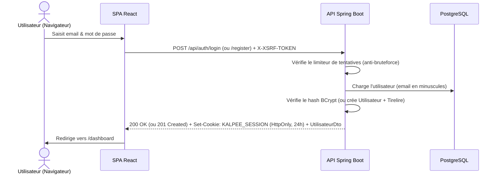
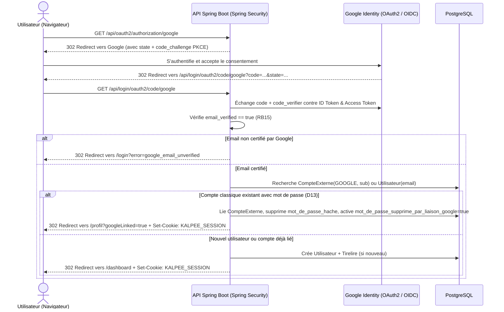

# Documentation de l'API REST — Kalpee MVP

Cette documentation présente de manière lisible et détaillée l'ensemble des endpoints REST du backend **Kalpee** (`com.kalpee`), les flux d'authentification (classique et Google OAuth2), la sécurité par cookie JWT + CSRF, le format uniforme des erreurs ainsi que des exemples complets de requêtes et de réponses JSON.

> [!TIP]
> La spécification formelle OpenAPI 3.0.3 correspondante est disponible dans le fichier [`docs/openapi.yaml`](file:///home/an0nymcoder/Documents/Projets/KalpeeNew/docs/openapi.yaml).

---

## 1. Principes généraux et conventions

- **Préfixe de base** : toutes les routes de l'API commencent par `/api`.
- **Format d'échange** : `application/json` (à l'exception du téléversement de photo en `multipart/form-data` et de la lecture binaire d'image).
- **Monnaie** : tous les montants sont exprimés en **FCFA** sous forme d'entiers (`BIGINT`), sans décimales (ex. `150000` pour `150 000 FCFA`).
- **Dates** :
  - Dates calendaires (`dateLimite`, `dateCible`) au format ISO `YYYY-MM-DD` (`2026-11-30`).
  - Horodatages (`dateCreation`, `date`) au format ISO-8601 UTC (`2026-10-22T21:00:00Z`).
- **Isolation des données (`RB01`)** : chaque requête est filtrée par l'utilisateur connecté. Toute tentative d'accès à une ressource inexistante ou appartenant à un autre utilisateur renvoie systématiquement `404 NOT_FOUND` (afin de ne pas révéler l'existence des ressources d'autrui).

### Énumérations de l'API

| Énumération | Valeurs autorisées | Usage |
|---|---|---|
| `Priorite` | `URGENT`, `IMPORTANT`, `NORMAL`, `FAIBLE` | Priorité d'un achat |
| `Categorie` | `VETEMENTS`, `ELECTRONIQUE`, `ACCESSOIRES`, `EQUIPEMENT`, `AUTRE` | Catégorie d'un achat ou d'un objectif (`D10`) |
| `StatutAchat` | `A_PLANIFIER`, `EN_COURS`, `TERMINE` | Statut **déduit** d'un achat (`D8`), jamais saisi |
| `StatutArticle` | `A_ACHETER`, `MIS_DE_COTE`, `ACHETE` | Statut d'acquisition d'un article (`F11`) |
| `TypeTransaction` | `DEPOT`, `RETRAIT` | Sens d'une opération dans la tirelire |
| `FournisseurExterne` | `GOOGLE` | Fournisseur OAuth2 (`D14`) |

---

## 2. Flux d'authentification et sécurité (Cookie JWT + CSRF + OAuth2 Google)

### 2.1 Session par Cookie JWT HttpOnly et protection CSRF

Kalpee n'expose jamais le jeton JWT au `localStorage` du navigateur pour prévenir tout vol de session par faille XSS :
1. **Cookie de session `KALPEE_SESSION`** :
   - Attributs : `HttpOnly`, `SameSite=Lax`, `Path=/`, `Max-Age=86400` (24 heures), `Secure` (en HTTPS).
   - Contient un jeton JWT signé par le serveur (algorithme HMAC-SHA256).
2. **Protection CSRF (Double Submit Cookie)** :
   - Spring Security dépose un cookie `XSRF-TOKEN` (`HttpOnly=false`) lisible par l'application React.
   - Le client HTTP (`Axios`) lit automatiquement `XSRF-TOKEN` et l'envoie dans l'en-tête `X-XSRF-TOKEN` pour chaque requête mutative (`POST`, `PUT`, `PATCH`, `DELETE`).

### 2.2 Flux 1 : Authentification classique (Email & Mot de passe)



### 2.3 Flux 2 : Authentification Google OAuth2 (Authorization Code + PKCE)

Conformément aux décisions `D12`, `D13` et aux règles `RB15`, `RB16` :



---

## 3. Format uniforme des erreurs

En cas d'erreur, l'API renvoie systématiquement un objet JSON structuré sans jamais exposer de trace technique (stacktrace SQL ou Java) :

```json
{
  "code": "VALIDATION_ERROR",
  "message": "Les données saisies sont invalides.",
  "details": {
    "nom": "Le nom est obligatoire",
    "quantite": "La quantité doit être supérieure ou égale à 1"
  }
}
```

| Code d'erreur (`code`) | Statut HTTP | Cas de déclenchement |
|---|---|---|
| `VALIDATION_ERROR` | `400 Bad Request` | Champs manquants, format invalide, règle `RB04`, `RB05`, `RB06`, `RB10`, `RB11` ou photo invalide. |
| `UNAUTHENTICATED` | `401 Unauthorized` | Cookie `KALPEE_SESSION` absent/expiré ou identifiants de connexion erronés. |
| `NOT_FOUND` | `404 Not Found` | Ressource introuvable ou appartenant à un autre utilisateur (`RB01`, `RB14`). |
| `EMAIL_ALREADY_USED` | `409 Conflict` | L'adresse email est déjà associée à un compte lors de l'inscription ou de la modification du profil. |
| `INSUFFICIENT_BALANCE` | `422 Unprocessable Entity` | Le montant du retrait dépasse le solde total disponible de la tirelire (`RB12`). |
| `OBJECTIVE_INSUFFICIENT` | `422 Unprocessable Entity` | Le retrait étiqueté dépasse le montant épargné sur l'objectif sélectionné (`RB13`). |
| `TOO_MANY_ATTEMPTS` | `429 Too Many Requests` | Trop d'échecs de connexion successifs ; blocage temporaire anti-bruteforce. |

---

## 4. Référence détaillée des Endpoints

### 4.1 Authentification et Profil (`/api/auth`, `/api/profil`)

#### `POST /api/auth/register` — Inscription (`F01`)
Crée un utilisateur, normalise son email en minuscules, hache son mot de passe avec BCrypt, crée sa `Tirelire` (`F12`) et ouvre immédiatement la session.

- **Requête :**
```json
{
  "nom": "Diarizo",
  "prenom": "Ouz",
  "email": "ouz@example.com",
  "motDePasse": "motdepasse123"
}
```
- **Réponse (`201 Created` + Cookie `KALPEE_SESSION`) :**
```json
{
  "id": 1,
  "nom": "Diarizo",
  "prenom": "Ouz",
  "email": "ouz@example.com",
  "aMotDePasse": true,
  "connexionGoogle": false,
  "motDePasseSupprimeParLiaisonGoogle": false,
  "dateCreation": "2026-10-22T21:00:00Z"
}
```

#### `POST /api/auth/login` — Connexion (`F02`)
- **Requête :**
```json
{
  "email": "ouz@example.com",
  "motDePasse": "motdepasse123"
}
```
- **Réponse (`200 OK` + Cookie `KALPEE_SESSION`) :** `UtilisateurDto`.

#### `POST /api/auth/logout` — Déconnexion
- **Réponse :** `204 No Content` (supprime le cookie `KALPEE_SESSION`).

#### `GET /api/auth/me` et `GET /api/profil` — Profil connecté (`F03`)
- **Réponse (`200 OK`) :** `UtilisateurDto` (permet au frontend de savoir si l'utilisateur est connecté, s'il possède un mot de passe `aMotDePasse`, si son compte est relié à Google `connexionGoogle` et si une liaison récente a supprimé son ancien mot de passe `motDePasseSupprimeParLiaisonGoogle`).

#### `PUT /api/profil` — Mise à jour des informations (`F03`)
- **Requête :**
```json
{
  "nom": "Diarizo",
  "prenom": "Ouz",
  "email": "ouz@example.com"
}
```
- **Réponse (`200 OK`) :** `UtilisateurDto`.

#### `PUT /api/profil/mot-de-passe` — Changement ou définition du mot de passe (`F03`, `D13`)
- **Requête :**
```json
{
  "motDePasseActuel": "motdepasse123",
  "nouveauMotDePasse": "nouveauMotDePasse456"
}
```
> [!NOTE]
> Si le compte a été créé via Google ou si son mot de passe a été supprimé lors d'une liaison Google (`aMotDePasse == false`), le champ `motDePasseActuel` peut être omis ou envoyé à `null`.

---

### 4.2 Module Achats (`/api/achats`)

#### `GET /api/achats?recherche=&priorite=` — Liste et filtrage des achats (`F07`, `F10`)
Paramètres de requête optionnels :
- `recherche` : filtre insensible à la casse sur le nom et la description.
- `priorite` : `URGENT`, `IMPORTANT`, `NORMAL` ou `FAIBLE`.

- **Réponse (`200 OK`) :**
```json
[
  {
    "id": 1,
    "nom": "Habits",
    "description": "Vêtements pour les vacances",
    "priorite": "URGENT",
    "categorie": "VETEMENTS",
    "dateLimite": "2026-09-15",
    "statut": "EN_COURS",
    "nombreArticles": 2,
    "nombreArticlesAchetes": 1,
    "total": 45000,
    "dejaAchete": 30000,
    "resteAAcheter": 15000,
    "progression": 67,
    "dateCreation": "2026-10-22T21:00:00Z"
  }
]
```

#### `GET /api/achats/{id}` — Détail d'un achat avec ses articles (`F07`)
- **Réponse (`200 OK`) :** mêmes champs que `AchatDto`, complétés par le tableau `"articles"` contenant les `ArticleDto`.

#### `POST /api/achats` (`201 Created`) & `PUT /api/achats/{id}` (`200 OK`) (`F04`, `F05`)
- **Requête :**
```json
{
  "nom": "Habits",
  "description": "Vêtements pour les vacances",
  "priorite": "URGENT",
  "categorie": "VETEMENTS",
  "dateLimite": "2026-09-15"
}
```
- **Réponse :** `AchatDto` (à la création, `statut` vaut automatiquement `"A_PLANIFIER"` et `total` vaut `0`).

#### `DELETE /api/achats/{id}` — Suppression d'un achat (`F06`)
Supprime l'achat, ses articles et leurs fichiers photos sur le disque.
- **Réponse :** `204 No Content`.

---

### 4.3 Module Articles et Photos (`/api/achats/{achatId}/articles`, `/api/articles`)

#### `GET /api/achats/{achatId}/articles` — Liste des articles d'un achat
- **Réponse (`200 OK`) :**
```json
[
  {
    "id": 10,
    "achatId": 1,
    "nom": "Jean noir",
    "description": "Jean noir coupe droite",
    "quantite": 2,
    "prixUnitaire": 15000,
    "total": 30000,
    "magasin": "Zara",
    "statut": "ACHETE",
    "aPhoto": true,
    "photoUrl": "/api/articles/10/photo"
  }
]
```

#### `POST /api/achats/{achatId}/articles` (`201 Created`) & `PUT /api/articles/{id}` (`200 OK`) (`F08`, `F09`)
- **Requête :**
```json
{
  "nom": "Jean noir",
  "description": "Jean noir coupe droite",
  "quantite": 2,
  "prixUnitaire": 15000,
  "magasin": "Zara",
  "statut": "A_ACHETER"
}
```
- **Réponse :** `ArticleDto` avec `"total": 30000` calculé automatiquement (`quantite * prixUnitaire`).

#### `PATCH /api/articles/{id}/statut` — Changement de statut et proposition de retrait (`F11`, `D3`)
Lorsque l'utilisateur passe le statut d'un article à `ACHETE`, l'API met à jour le statut et renvoie un objet `retraitSuggere` pré-rempli permettant au frontend d'ouvrir la modale de confirmation de retrait.

- **Requête :**
```json
{
  "statut": "ACHETE"
}
```
- **Réponse (`200 OK`) :**
```json
{
  "article": {
    "id": 10,
    "achatId": 1,
    "nom": "Jean noir",
    "description": "Jean noir coupe droite",
    "quantite": 2,
    "prixUnitaire": 15000,
    "total": 30000,
    "magasin": "Zara",
    "statut": "ACHETE",
    "aPhoto": true,
    "photoUrl": "/api/articles/10/photo"
  },
  "retraitSuggere": {
    "montant": 30000,
    "motif": "Achat : Jean noir (Habits)",
    "articleId": 10
  }
}
```

#### `DELETE /api/articles/{id}` — Suppression d'un article (`F08`)
- **Réponse :** `204 No Content`.

#### `POST /api/articles/{id}/photo` — Téléversement de photo
- **Requête :** `multipart/form-data` avec un champ `file` (formats acceptés : `image/jpeg`, `image/png`, `image/webp` vérifiés par signature binaire / magic bytes ; taille maximale : `5 Mo`).
- **Réponse (`200 OK`) :** `ArticleDto` mis à jour (`"aPhoto": true`, `"photoUrl": "/api/articles/10/photo"`).

#### `GET /api/articles/{id}/photo` — Lecture sécurisée de la photo
- **Réponse (`200 OK`) :** flux binaire de l'image avec l'en-tête `Content-Type` approprié, accessible uniquement au propriétaire de l'article.

#### `DELETE /api/articles/{id}/photo` — Suppression de la photo
- **Réponse :** `204 No Content`.

---

### 4.4 Module Tirelire et Transactions (`/api/tirelire`)

#### `GET /api/tirelire` — État de la tirelire (`F12`)
- **Réponse (`200 OK`) :**
```json
{
  "solde": 150000,
  "totalDepose": 180000,
  "totalRetire": 30000
}
```

#### `POST /api/tirelire/depot` — Dépôt d'argent (`F13`, `D1`)
Permet d'ajouter des fonds dans la tirelire, en étiquetant optionnellement un objectif d'épargne.
- **Requête :**
```json
{
  "montant": 25000,
  "motif": "Épargne mensuelle",
  "objectifId": 1
}
```
- **Réponse (`201 Created`) :**
```json
{
  "id": 1,
  "type": "DEPOT",
  "montant": 25000,
  "motif": "Épargne mensuelle",
  "date": "2026-10-22T21:00:00Z",
  "objectifId": 1,
  "objectifNom": "Acheter mon ordinateur",
  "articleId": null,
  "articleNom": null
}
```

#### `POST /api/tirelire/retrait` — Retrait d'argent (`F14`, `RB12`, `RB13`)
Exécuté dans une transaction verrouillant la tirelire (`PESSIMISTIC_WRITE`). Vérifie que le solde global est suffisant (`422 INSUFFICIENT_BALANCE` sinon) et, si `objectifId` est renseigné, que l'épargne de cet objectif couvre le retrait (`422 OBJECTIVE_INSUFFICIENT` sinon).
- **Requête :**
```json
{
  "montant": 30000,
  "motif": "Achat : Jean noir (Habits)",
  "objectifId": null,
  "articleId": 10
}
```
- **Réponse (`201 Created`) :** `TransactionDto`.

#### `GET /api/tirelire/transactions?page=0&size=20` — Historique paginé (`F15`)
- **Réponse (`200 OK`) :**
```json
{
  "content": [
    {
      "id": 2,
      "type": "RETRAIT",
      "montant": 30000,
      "motif": "Achat : Jean noir (Habits)",
      "date": "2026-10-22T21:05:00Z",
      "objectifId": null,
      "objectifNom": null,
      "articleId": 10,
      "articleNom": "Jean noir"
    },
    {
      "id": 1,
      "type": "DEPOT",
      "montant": 25000,
      "motif": "Épargne mensuelle",
      "date": "2026-10-22T21:00:00Z",
      "objectifId": 1,
      "objectifNom": "Acheter mon ordinateur",
      "articleId": null,
      "articleNom": null
    }
  ],
  "page": 0,
  "size": 20,
  "totalElements": 2,
  "totalPages": 1,
  "hasNext": false
}
```

---

### 4.5 Module Objectifs d'épargne (`/api/objectifs`)

#### `GET /api/objectifs` & `GET /api/objectifs/{id}` — Suivi et effort d'épargne (`F17`, `F18`)
- **Réponse (`200 OK`) :**
```json
{
  "id": 1,
  "nom": "Acheter mon ordinateur",
  "description": "Un bon PC pour le travail",
  "montantCible": 300000,
  "montantInitial": 150000,
  "montantEpargne": 175000,
  "reste": 125000,
  "progression": 58,
  "dateCible": "2026-11-30",
  "categorie": "ELECTRONIQUE",
  "epargneMensuelleRecommandee": 62500,
  "moisRestants": 2,
  "atteint": false,
  "dateCreation": "2026-10-22T21:00:00Z"
}
```

#### `POST /api/objectifs` (`201 Created`) & `PUT /api/objectifs/{id}` (`200 OK`) (`F16`)
- **Requête :**
```json
{
  "nom": "Acheter mon ordinateur",
  "description": "Un bon PC pour le travail",
  "montantCible": 300000,
  "montantInitial": 150000,
  "dateCible": "2026-11-30",
  "categorie": "ELECTRONIQUE"
}
```

#### `DELETE /api/objectifs/{id}` — Suppression d'un objectif
- **Réponse :** `204 No Content` (les transactions autrefois étiquetées avec cet objectif sont conservées et leur `objectifId` passe à `null`).

---

### 4.6 Module Dashboard (`/api/dashboard`)

#### `GET /api/dashboard` — Vue synthétique complète
Renvoie en un seul appel réseau l'intégralité des indicateurs du tableau de bord :
- **Budget** : `solde`, `totalDepose`, `totalRetire`.
- **Achats** : `nombreAchats`, `totalPrevu`, `dejaAchete`, `resteAFinancer`, `progressionAchats`.
- **Priorités** : répartition `achatsParPriorite` (`URGENT`, `IMPORTANT`, `NORMAL`, `FAIBLE`).
- **Épargne** : `nombreObjectifsEnCours` et `objectifPrincipal` (l'objectif non atteint dont la `dateCible` est la plus proche).
- **Achats prioritaires** : les 3 achats non terminés les plus prioritaires (triés par priorité décroissante puis par `dateLimite` croissante).

- **Réponse (`200 OK`) :**
```json
{
  "solde": 150000,
  "totalDepose": 180000,
  "totalRetire": 30000,
  "nombreAchats": 4,
  "totalPrevu": 520000,
  "dejaAchete": 150000,
  "resteAFinancer": 370000,
  "progressionAchats": 29,
  "achatsParPriorite": {
    "URGENT": 1,
    "IMPORTANT": 1,
    "NORMAL": 1,
    "FAIBLE": 1
  },
  "nombreObjectifsEnCours": 2,
  "objectifPrincipal": {
    "id": 1,
    "nom": "Acheter mon ordinateur",
    "description": "Un bon PC pour le travail",
    "montantCible": 300000,
    "montantInitial": 150000,
    "montantEpargne": 175000,
    "reste": 125000,
    "progression": 58,
    "dateCible": "2026-11-30",
    "categorie": "ELECTRONIQUE",
    "epargneMensuelleRecommandee": 62500,
    "moisRestants": 2,
    "atteint": false,
    "dateCreation": "2026-10-22T21:00:00Z"
  },
  "achatsPrioritaires": [
    {
      "id": 1,
      "nom": "Habits",
      "description": "Vêtements pour les vacances",
      "priorite": "URGENT",
      "categorie": "VETEMENTS",
      "dateLimite": "2026-09-15",
      "statut": "EN_COURS",
      "nombreArticles": 2,
      "nombreArticlesAchetes": 1,
      "total": 45000,
      "dejaAchete": 30000,
      "resteAAcheter": 15000,
      "progression": 67,
      "dateCreation": "2026-10-22T21:00:00Z"
    }
  ]
}
```
