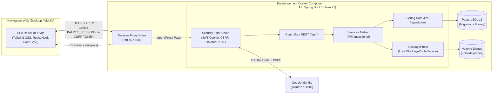

# Documentation Technique — Kalpee MVP

Ce document détaille l'architecture logicielle et système de **Kalpee**, la justification technique des décisions de conception (`D1` à `D14`), les mécanismes de sécurité mis en œuvre, ainsi que les procédures d'installation, de configuration, de test et de déploiement via Docker Compose.

---

## 1. Architecture globale

Kalpee repose sur une architecture **3-tiers conteneurisée** servie derrière un point d'entrée unique (Reverse Proxy Nginx) afin d'unifier le domaine entre le frontend et l'API REST :



### 1.1 Structure des paquets Backend (`com.kalpee`)

Le backend Spring Boot suit une architecture en couches stricte et découplée :
- `com.kalpee.config` : configuration CORS, Jackson, OpenAPI, stockage photo et propriétés applicatives.
- `com.kalpee.security` : filtre d'authentification par cookie JWT (`JwtAuthenticationFilter`), gestionnaire OAuth2 Google (`OAuth2LoginSuccessHandler`, `OAuth2LoginFailureHandler`), protection CSRF et limiteur de tentatives de connexion (`LoginAttemptService`).
- `com.kalpee.controller` : contrôleurs REST exposant les routes `/api/auth`, `/api/profil`, `/api/achats`, `/api/articles`, `/api/tirelire`, `/api/objectifs` et `/api/dashboard`.
- `com.kalpee.service` : logique métier, calculs financiers en FCFA, contrôle d'accès par utilisateur (`RB01`), verrouillage pessimiste sur la tirelire et abstraction `StockagePhoto`.
- `com.kalpee.repository` : interfaces Spring Data JPA avec requêtes JPQL optimisées et verrous transactionnels (`@Lock(LockModeType.PESSIMISTIC_WRITE)`).
- `com.kalpee.entity` : entités JPA mappées sur le schéma PostgreSQL géré par Flyway (`src/main/resources/db/migration/`).
- `com.kalpee.dto` & `com.kalpee.mapper` : objets de transfert de données validés par Jakarta Bean Validation et convertisseurs entité ↔ DTO.
- `com.kalpee.exception` : `@RestControllerAdvice` centralisant toutes les erreurs vers le format JSON uniforme (`ErrorResponse`).

### 1.2 Architecture Frontend (`frontend/`)

L'application cliente est une Single Page Application (SPA) construite avec :
- **React 18 & Vite** pour la réactivité et la rapidité de build.
- **React Router v6** avec gardes de navigation (`ProtectedRoute`, redirection automatique vers `/login` en cas d'expiration de session `401`).
- **Tailwind CSS & Lucide React** : design responsive comprenant une **Sidebar latérale** sur ordinateur et une **Bottom Navigation Bar à 4 entrées** sur mobile.
- **React Hook Form & Zod** : validation déclarative côté client alignée sur les règles métier (`RB04` à `RB11`) et affichage des erreurs par champ renvoyées par le serveur.
- **Axios** : instance centralisée configurée avec `withCredentials: true` et gestion automatique de l'en-tête anti-CSRF `X-XSRF-TOKEN`.

---

## 2. Explication technique des décisions de conception (D1 à D14)

| # | Décision | Implémentation technique |
|---|---|---|
| **D1** | **Objectif d'épargne et tirelire liés** | La table `transaction` possède une clé étrangère optionnelle `objectif_id`. Lors d'un dépôt ou d'un retrait, l'utilisateur peut étiqueter un objectif d'épargne. Le montant épargné d'un objectif est calculé par $\text{montantInitial} + \sum \text{DEPOT}_{\text{objectif}} - \sum \text{RETRAIT}_{\text{objectif}}$. |
| **D2** | **Solde unique de la tirelire** | L'étiquette `objectif_id` sur une transaction est analytique : la tirelire conserve un solde global unique. Tout retrait non étiqueté est autorisé tant que le solde global de la tirelire suffit (`RB12`). Si un retrait est étiqueté avec un objectif, il vérifie en plus que l'épargne de cet objectif est suffisante (`RB13`). |
| **D3** | **Article « Acheté » → Retrait proposé** | L'endpoint `PATCH /api/articles/{id}/statut` avec `statut = ACHETE` ne débite jamais la tirelire de manière silencieuse. Il retourne un objet `retraitSuggere` (`montant = quantite * prixUnitaire`, `motif = "Achat : <article> (<achat>)"`, `articleId`). Le frontend ouvre une modale pré-remplie que l'utilisateur peut modifier, confirmer (`POST /api/tirelire/retrait`) ou refuser tout en conservant l'article à l'état `ACHETE`. |
| **D4** | **Soldes et totaux calculés à la lecture** | Aucune colonne `solde`, `total` ou `progression` n'est stockée en base (`RB07`, `RB08`). Les services et mappers calculent ces valeurs à la lecture à partir des lignes d'articles et des transactions, garantissant l'absence totale de désynchronisation. |
| **D5** | **Stack SPA React + Spring Boot + PostgreSQL** | Séparation claire entre le rendu client (SPA), l'API REST stateless authentifiée par cookie JWT et le moteur transactionnel relationnel PostgreSQL géré par Flyway. |
| **D6** | **Outillage Frontend moderne** | Utilisation combinée de Vite, React Router, Tailwind CSS, Axios, React Hook Form, Zod et Lucide React pour une expérience fluide et maintenable. |
| **D7** | **Absence d'abonnement dans le MVP** | Aucune colonne de quota ou d'abonnement en base de données ; toutes les fonctionnalités du MVP sont illimitées. |
| **D8** | **Statut d'un achat déduit automatiquement** | Méthode métier déterministe : `A_PLANIFIER` si `articles.isEmpty()`, `TERMINE` si tous les articles ont `statut == ACHETE`, `EN_COURS` dans tous les autres cas (un article `MIS_DE_COTE` est compté comme non acheté). |
| **D9** | **Progression d'un achat en montant** | $\text{progression} = \text{round}(\text{dejaAchete} \times 100.0 / \text{total})$ (retourne `0` si `total == 0`), ce qui reflète fidèlement l'effort financier réel plutôt que le simple nombre d'articles. |
| **D10** | **Catégories fixes partagées** | Une seule énumération `Categorie` (`VETEMENTS`, `ELECTRONIQUE`, `ACCESSOIRES`, `EQUIPEMENT`, `AUTRE`) est utilisée à la fois par `Achat` et `ObjectifEpargne`. |
| **D11** | **Identité produit Kalpee** | Nommage unifié `Kalpee` dans toute l'interface, les paquets Java (`com.kalpee`) et le cookie `KALPEE_SESSION`. |
| **D12** | **Connexion Google OAuth2 côté serveur** | Spring Security gère le flux Authorization Code avec `state` et PKCE (`/api/oauth2/authorization/google` → `/api/login/oauth2/code/google`), puis émet le même cookie `KALPEE_SESSION` que la connexion par email/mot de passe. |
| **D13** | **Liaison automatique de compte & protection contre la pré-inscription frauduleuse** | Comme l'inscription classique ne vérifie pas l'email par lien de confirmation, un tiers pourrait créer un compte avec l'adresse Gmail d'une victime avant elle. Lorsque le propriétaire légitime se connecte avec Google (`email_verified == true`), Kalpee lie le `CompteExterne` au compte existant, **supprime l'ancien `mot_de_passe_hache`** (`NULL`) et positionne `mot_de_passe_supprime_par_liaison_google = true`. L'attaquant perd immédiatement tout accès et l'utilisateur légitime est informé dans « Mon compte » qu'il peut définir un nouveau mot de passe. |
| **D14** | **Extensibilité multi-fournisseurs (Apple)** | L'entité `CompteExterne` stocke le couple `(fournisseur, identifiant_fournisseur)` dans une table dédiée (relation `1..*` depuis `Utilisateur`), permettant d'ajouter `APPLE` ultérieurement sans modifier le schéma de `utilisateur`. |

---

## 3. Sécurité approfondie

### 3.1 Hachage des mots de passe et anti-bruteforce
- **BCrypt** : les mots de passe (minimum 8 caractères) sont hachés via `BCryptPasswordEncoder` (coût par défaut 10 avec sel aléatoire intégré).
- **Normalisation de l'email** : toute adresse email est convertie en minuscules (`email.trim().toLowerCase(Locale.ROOT)`) avant persistance ou recherche, doublée d'une contrainte PostgreSQL `CHECK (email = LOWER(email))`.
- **Limitation des tentatives (`TOO_MANY_ATTEMPTS`)** : un compteur en mémoire indexé par adresse email/IP bloque temporairement les tentatives de connexion après plusieurs échecs consécutifs et renvoie `429 Too Many Requests`.

### 3.2 Cookie JWT HttpOnly et protection CSRF
- Le jeton JWT est transporté exclusivement dans le cookie `KALPEE_SESSION` (`HttpOnly=true`, `SameSite=Lax`, `Path=/`, validité `24h`).
- La protection CSRF est assurée par `CookieCsrfTokenRepository.withHttpOnlyFalse()` combiné à un gestionnaire acceptant l'en-tête `X-XSRF-TOKEN` envoyé par le client React.

### 3.3 Sécurité OAuth2 Google (PKCE + `email_verified`)
- Spring Security génère automatiquement les paramètres `state` (anti-CSRF OAuth2) et `code_challenge` / `code_verifier` (PKCE).
- À la réception du profil OIDC Google, le serveur vérifie impérativement l'attribut `email_verified == true` (`RB15`). Tout compte Google dont l'email n'est pas certifié est rejeté avec redirection vers `/login?error=google_email_unverified`.

### 3.4 Concurrence et verrouillage pessimiste sur `Tirelire` (`RB12`, `RB13`)
Afin d'empêcher deux requêtes de retrait simultanées (race condition / double dépense) de faire passer le solde en négatif :
1. La méthode de retrait s'exécute dans une transaction `@Transactional`.
2. Elle acquiert un **verrou pessimiste en écriture** sur la ligne `tirelire` de l'utilisateur via `@Lock(LockModeType.PESSIMISTIC_WRITE)` (`SELECT ... FROM tirelire WHERE utilisateur_id = :uid FOR UPDATE`).
3. Toute transaction concurrente de retrait pour le même utilisateur est mise en file d'attente par PostgreSQL jusqu'au `COMMIT` de la première.
4. Le solde disponible (et, le cas échéant, l'épargne de l'objectif étiqueté) est calculé **après** l'acquisition du verrou avant d'autoriser l'insertion du `RETRAIT`.

### 3.5 Validation des photos d'articles (Magic Bytes & Isolation)
- **Taille maximale** : 5 Mo (`5 242 880` octets).
- **Inspection des octets d'en-tête (Magic Bytes)** : le service ne se fie ni à l'extension du nom de fichier ni au `Content-Type` déclaré par le navigateur. Il inspecte les premiers octets du flux binaire :
  - **JPEG** : `FF D8 FF`
  - **PNG** : `89 50 4E 47 0D 0A 1A 0A`
  - **WebP** : `52 49 46 46 ... 57 45 42 50` (`RIFF....WEBP`)
- **Stockage sécurisé derrière `StockagePhoto`** : le fichier est renommé avec un `UUID` aléatoire (aucun risque de *Path Traversal*) sur un répertoire non exposé publiquement. La lecture passe exclusivement par `GET /api/articles/{id}/photo` après vérification que l'article appartient à l'utilisateur connecté (`RB01`).

---

## 4. Installation, Configuration, Tests et Déploiement

### 4.1 Prérequis
- **Docker** ($\ge 24$) et **Docker Compose** ($\ge 2.20$) pour le déploiement conteneurisé.
- Pour le développement local hors Docker :
  - **Java 21 (JDK 21)** et **Maven 3.9+**
  - **Node.js 20+** et **npm 10+**
  - **PostgreSQL 16**

### 4.2 Variables d'environnement (`.env`)

Créez un fichier `.env` à la racine du projet (ou utilisez les valeurs par défaut de développement pour démarrer immédiatement) :

```dotenv
# Base de données PostgreSQL
POSTGRES_DB=kalpee
POSTGRES_USER=kalpee
POSTGRES_PASSWORD=kalpee_secret_password
SPRING_DATASOURCE_URL=jdbc:postgresql://postgres:5432/kalpee

# Sécurité JWT (clé secrète de 256 bits minimum)
APP_JWT_SECRET=kalpee-super-secret-jwt-key-minimum-32-bytes-long-2026
APP_JWT_EXPIRATION_SECONDS=86400
APP_COOKIE_SECURE=false

# Stockage des photos d'articles
APP_STORAGE_PHOTOS_DIR=/var/lib/kalpee/photos

# Google Cloud OAuth2 (Optionnel en local si vous utilisez la connexion par email)
GOOGLE_CLIENT_ID=votre-client-id.apps.googleusercontent.com
GOOGLE_CLIENT_SECRET=votre-client-secret
APP_FRONTEND_URL=http://localhost:3000
```

#### Configuration de la console Google Cloud OAuth2
Pour activer le bouton « Continuer avec Google » avec de vrais comptes Google :
1. Rendez-vous sur [Google Cloud Console](https://console.cloud.google.com/) > **APIs & Services** > **OAuth consent screen** et configurez l'écran de consentement (scopes `openid`, `profile`, `email`).
2. Dans **Credentials** > **Create Credentials** > **OAuth client ID** (type *Web application*), déclarez les **Authorized redirect URIs** :
   - Développement via Docker / Reverse Proxy : `http://localhost:3000/api/login/oauth2/code/google`
   - Développement direct sur Spring Boot : `http://localhost:8080/api/login/oauth2/code/google`
   - Production : `https://<votre-domaine>/api/login/oauth2/code/google`
3. Renseignez `GOOGLE_CLIENT_ID` et `GOOGLE_CLIENT_SECRET` dans votre fichier `.env`.

### 4.3 Lancement des tests automatisés

#### Tests Backend (Unitaires, Services, Intégration & OAuth2 simulé)
```bash
cd backend
mvn test
```
La suite de tests backend couvre :
- Les calculs financiers en FCFA (totaux d'articles et d'achats, statut déduit, solde de tirelire, progression d'objectif, épargne mensuelle recommandée et cas limites).
- Les règles métier `RB01` à `RB16` (isolation inter-utilisateurs renvoyant `404`, refus de retrait en cas de solde insuffisant `422`, concurrence sur les retraits simultanés avec verrouillage pessimiste, validation des magic bytes des photos).
- Les flux OAuth2 Google simulés (création de compte, reconnexion, liaison automatique avec suppression de l'ancien mot de passe `D13`, rejet d'un email non certifié `RB15`).

#### Tests Frontend (Vitest & React Testing Library)
```bash
cd frontend
npm test
```
La suite de tests frontend vérifie le formatage des montants en FCFA, les schémas de validation Zod des formulaires et le flux interactif « Marquer un article comme Acheté → Proposition de retrait dans la tirelire ».

### 4.4 Déploiement avec Docker Compose

Depuis la racine du projet :

```bash
docker compose up --build -d
```

Cette commande construit et démarre l'ensemble de la pile :
1. **`postgres`** : base PostgreSQL 16 avec volume persistant et healthcheck.
2. **`backend`** : API Spring Boot exécutant automatiquement les migrations Flyway au démarrage et montant le volume persistant des photos.
3. **`frontend` (Nginx)** : sert la SPA React compilée et redirige toutes les requêtes `/api/*` vers le conteneur `backend` sous un domaine unique.

Une fois les conteneurs démarrés, l'application est accessible sur :
- **Application Web Kalpee** : `http://localhost:3000` (ou `http://localhost:80` selon le port exposé)

Pour arrêter les services :
```bash
docker compose down
```
